# Lab 2: Group Policy, File Shares and PowerShell

## Goal
Build on the Lab 1 domain so that users can reach only the shared folders for their own department (HR, Finance or IT), using security groups, NTFS and share permissions, and PowerShell. Group Policy then maps the right drives automatically when a user signs in to CLIENT1, while a user outside the group never sees the drive and is denied if they try the path directly.

## Progress
- [x] Snapshots taken on both VMs before changes
- [x] OU for workstations created and CLIENT1 moved into it
- [x] Security groups created and users added with PowerShell
- [x] Shared folders created under C:\Shares
- [x] NTFS permissions set per group
- [x] SMB shares created
- [x] Access tested as an allowed user and a denied user
- [x] GPO created and linked to the users OU
- [x] Drive maps deployed with item-level targeting
- [x] Computer GPO (logon banner) applied to the workstations OU
- [x] Policy results verified with gpresult

## Environment
| Item | Value |
|------|-------|
| Hypervisor | VMware Workstation |
| Domain controller | `ADDC01`, Windows Server 2022 (built in Lab 1) |
| Client | `CLIENT1`, Windows 10 Pro (domain-joined in Lab 1) |
| Domain | `kinglab.local` (NetBIOS: `KINGLAB`) |
| Share root | `C:\Shares` on `ADDC01` |

## Design

Access is controlled in three layers, each doing a different job:

| Layer | Job |
|-------|-----|
| Share permissions | Front door: `Authenticated Users` get Change on every share |
| NTFS permissions | The real lock: only the matching group can open each department folder |
| Group Policy | Convenience: maps the right drive letters at sign-in, so users never type a path |

| Folder | Share | Who can open it (NTFS) | Drive map |
|--------|-------|------------------------|-----------|
| HR | `\\ADDC01\HR` | `GG-HR` | `H:` for `GG-HR` only |
| Finance | `\\ADDC01\Finance` | `GG-Finance` | `F:` for `GG-Finance` only |
| IT | `\\ADDC01\IT` | `GG-IT` | `I:` for `GG-IT` only |
| Company | `\\ADDC01\Company` | `Domain Users` | `S:` for everyone |

| Group | Members |
|-------|---------|
| `GG-HR` | msantos, areyes, lmendoza |
| `GG-Finance` | jdelacruz, cgarcia, jramos |
| `GG-IT` | mvillanueva, gbautista, baquino |

`pcruz` is in none of the department groups. He is the control user: a valid domain account that should be denied everywhere except `Company`.

| OU | GPO linked | Applies to |
|----|-----------|------------|
| `_USERS` | `USR-Drive-Mappings` | User accounts (drive maps follow the person) |
| `_WORKSTATIONS` | `COMP-Logon-Banner` | Computer accounts (banner applies to the machine) |

## Steps

### 1. Take snapshots before changing anything
Group Policy changes can lock users out, so I took a snapshot named `Lab2-shares-done` on both VMs before the GPO work. The `LAB 1 complete` snapshot from the end of Lab 1 was already there.
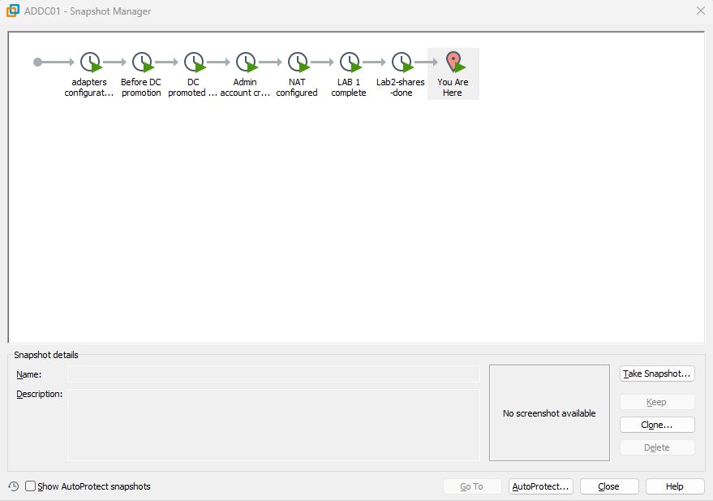
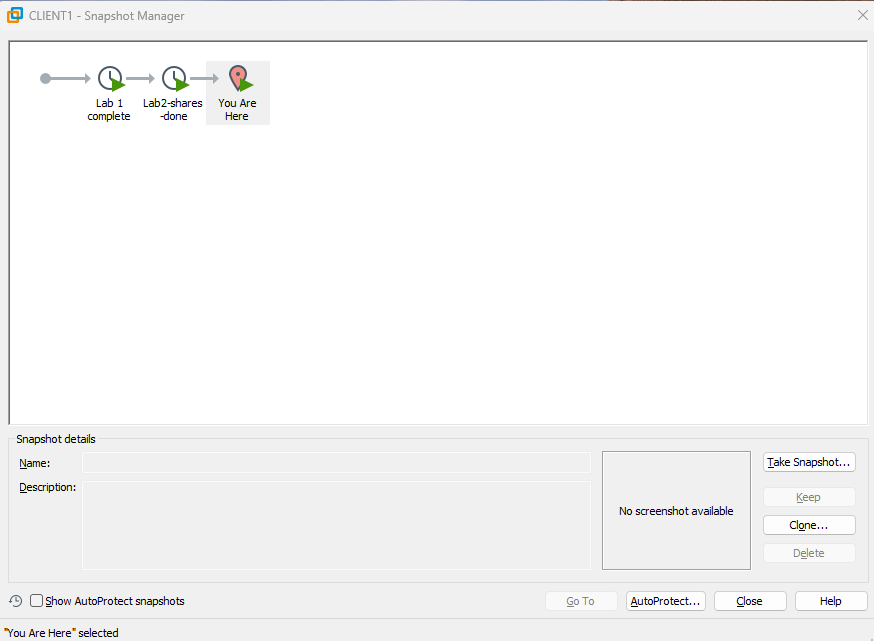

### 2. Create a workstations OU and move CLIENT1 into it
GPOs can only be linked to a site, the domain or an OU, and the default Computers container is not an OU. I created `_WORKSTATIONS` and moved `CLIENT1` into it so computer policy has somewhere to land.
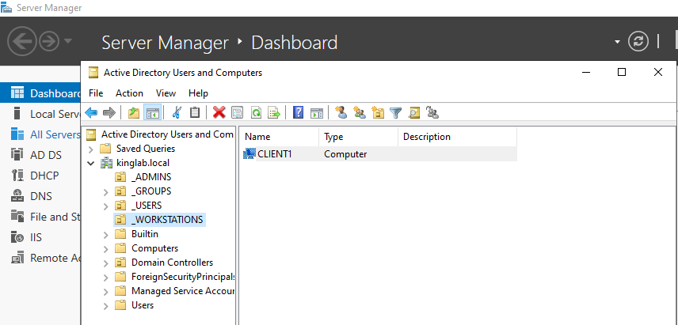

### 3. Create the groups
Created a `_GROUPS` OU and three global security groups: `GG-HR`, `GG-Finance` and `GG-IT`. Folder access is given to groups, not to individual users, so a person joining or leaving a team only changes group membership and never the folder permissions.
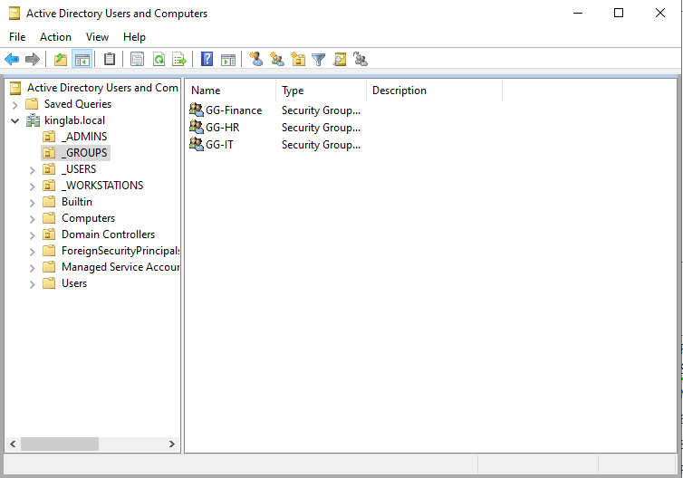

### 4. Add users to the groups with PowerShell
[`Add-LabGroupMembers.ps1`](Add-LabGroupMembers.ps1) loops through each group and its users and adds them with `Add-ADGroupMember`. Errors are caught and printed in red, so a failure is not hidden behind a "success" message. This is where the first problem showed up (see Problems below).
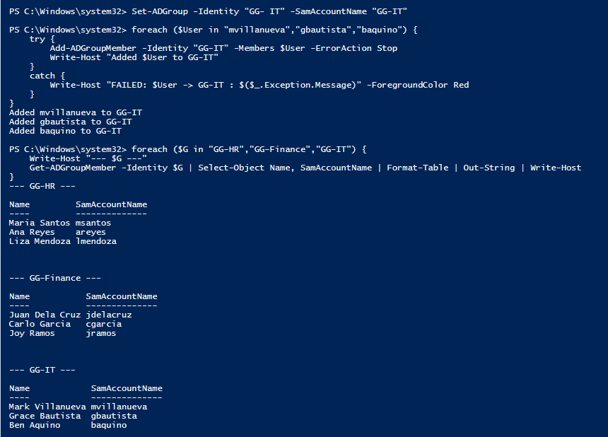

### 5. Create the folder structure
[`New-ShareFolders.ps1`](New-ShareFolders.ps1) creates the folders under `C:\Shares`. The original script made `HR`, `Finance` and `IT`; I added `Company` by hand as an all-staff folder and added it to the script afterwards.
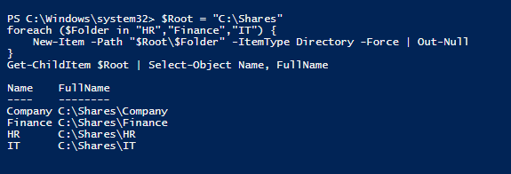

### 6. Set NTFS permissions
[`Set-SharePermissions.ps1`](Set-SharePermissions.ps1) uses `icacls` to remove inherited permissions and grant explicit ones: Administrators and SYSTEM get Full Control, each department folder gets Modify for its own group only, and `Company` gets Modify for `Domain Users`. I removed inheritance so the broad default permissions from `C:\` (like `BUILTIN\Users`) do not flow into the folders.
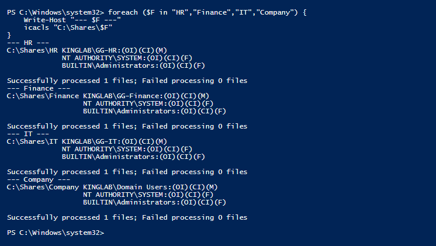

### 7. Create the SMB shares
[`New-LabShares.ps1`](New-LabShares.ps1) publishes each folder as a share with `Authenticated Users` at Change. The share is a loose door on purpose, and the NTFS permissions do the real restricting. When both layers apply, the more restrictive one wins.
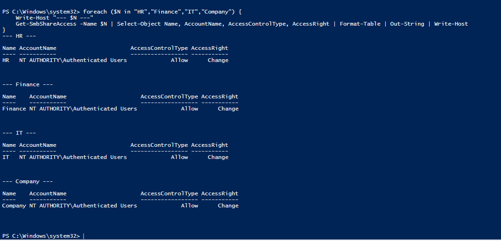

### 8. Test as an HR user (msantos)
Signed in to `CLIENT1` as `KINGLAB\msantos` and opened each path from the Run box. He can open and save files in `HR` and `Company`, and is denied on `Finance` and `IT`.
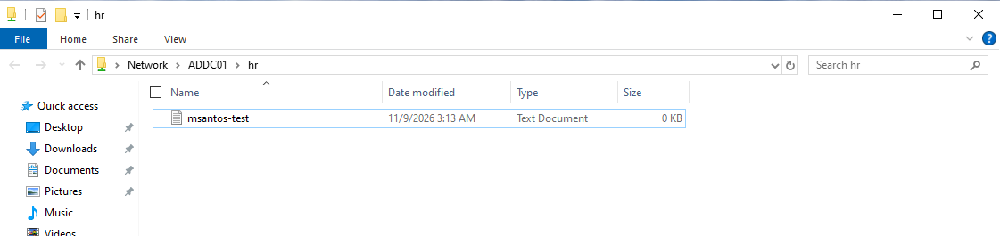
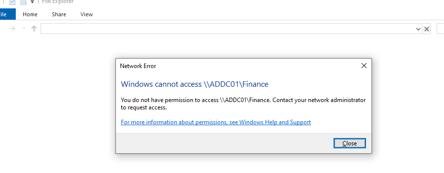
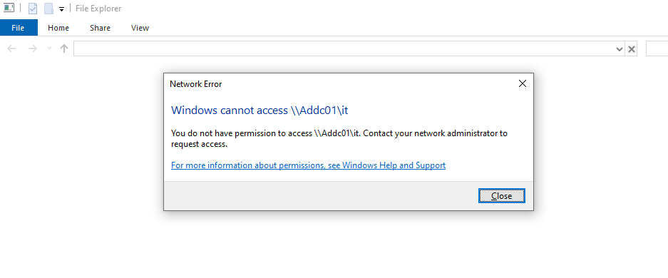
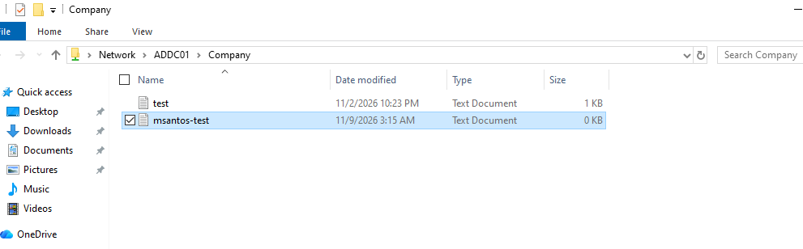

### 9. Test as the control user (pcruz)
Signed in as `KINGLAB\pcruz`, who is in no department group. He is denied on `HR`, `Finance` and `IT`, and can read and write in `Company` because he is a member of `Domain Users`. The first screenshot is his security group list from `gpresult`, which has no `GG-` groups.
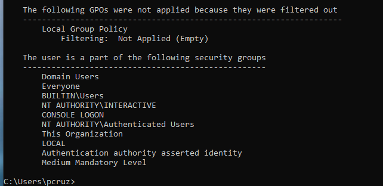
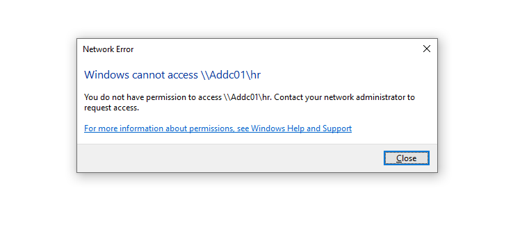
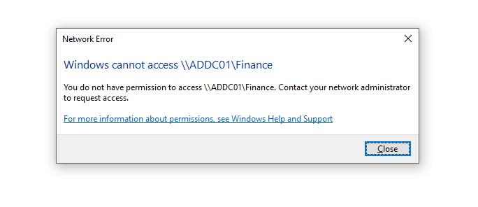
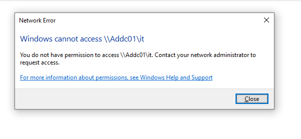
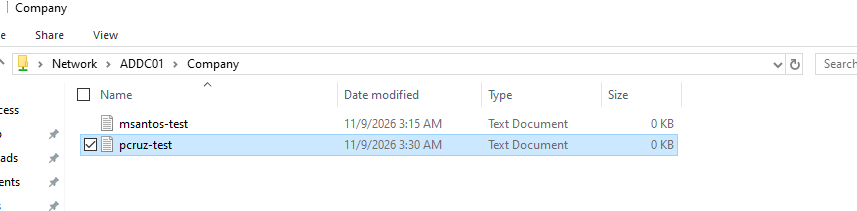

### 10. Create and link a GPO for the users
In Group Policy Management I created `USR-Drive-Mappings` and linked it to the `_USERS` OU. Creating a GPO only makes a container for settings, and the link decides where the settings apply. Linked while empty, it changes nothing until settings are added.
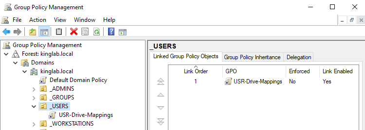

### 11. Map the Company drive for everyone
In the GPO, under User Configuration > Preferences > Windows Settings > Drive Maps, I added `\\ADDC01\Company` as `S:`. After `gpupdate /force` and a sign-out and sign-in, `msantos` sees it under Network locations in This PC, separate from the local `C:` drive.
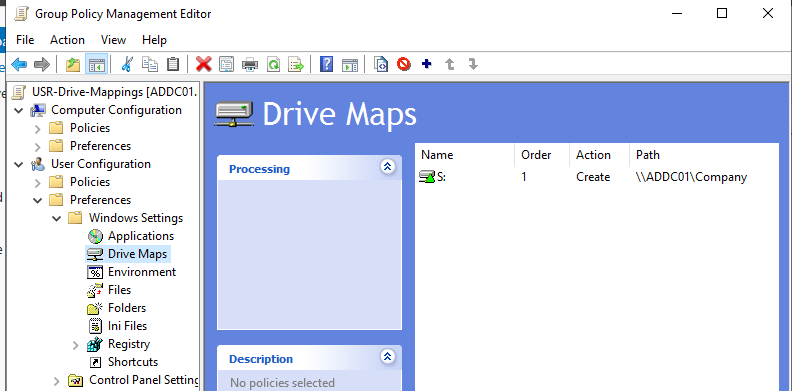
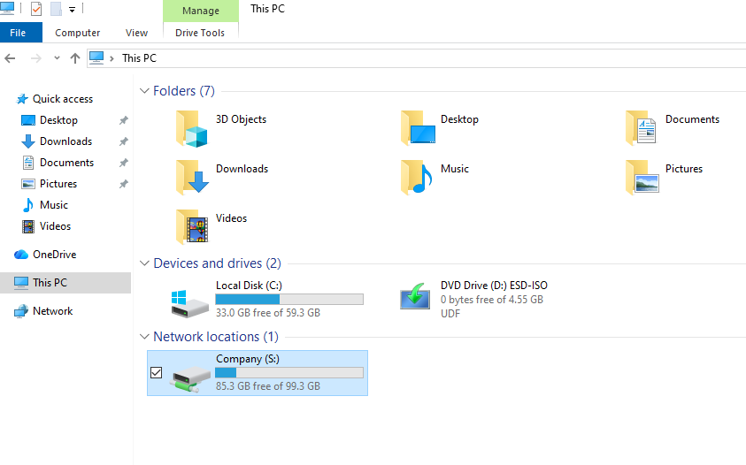

### 12. Map the HR drive for HR members only
Added `\\ADDC01\HR` as `H:` and used item-level targeting ("User in group" `GG-HR`) so only HR members see it. Targeting controls what appears, not who can get in. The NTFS permissions still decide that. `msantos` sees `H:` and `pcruz` does not.
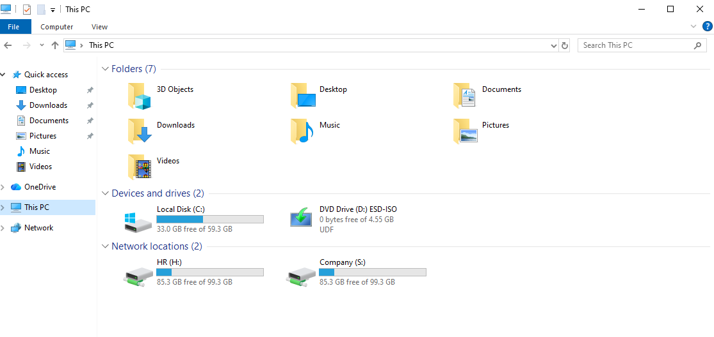
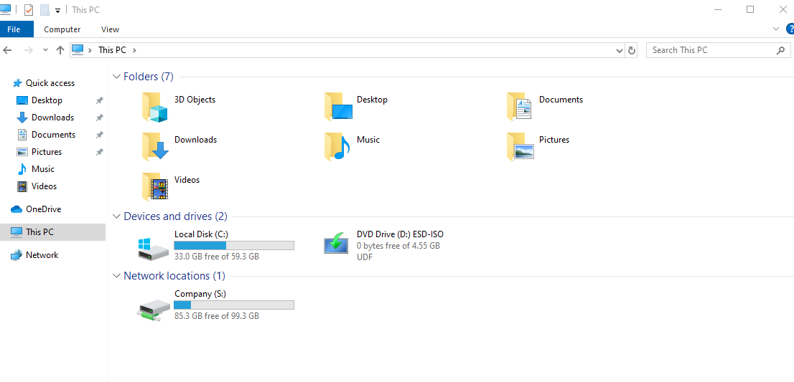

### 13. Map the Finance and IT drives
Repeated the same method for `F:` (`GG-Finance`) and `I:` (`GG-IT`). One GPO now gives different users different sets of drives, because each drive map carries its own targeting rule. `jdelacruz` sees `S:` and `F:`, and `mvillanueva` sees `S:` and `I:`.
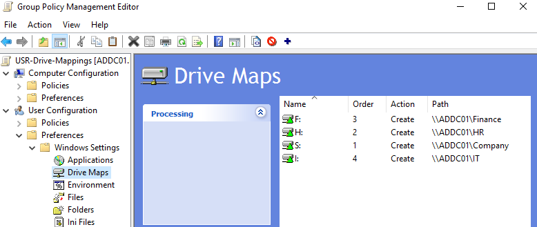
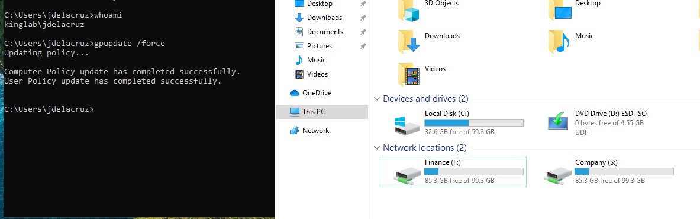
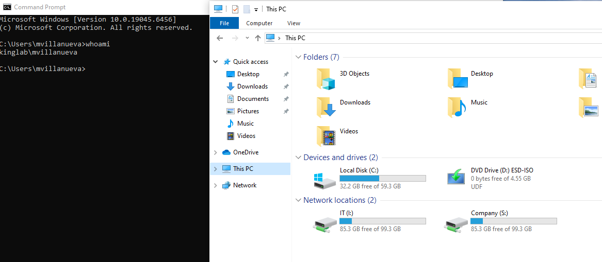

### 14. Add a computer-side GPO: logon banner
Created `COMP-Logon-Banner` linked to `_WORKSTATIONS`, with the Security Options settings for the logon message title and text. Unlike the drive maps, which follow the user, this applies to the machine, so it shows at the sign-in screen before anyone has typed a username. I ran `gpupdate /force` and restarted `CLIENT1` to test it.
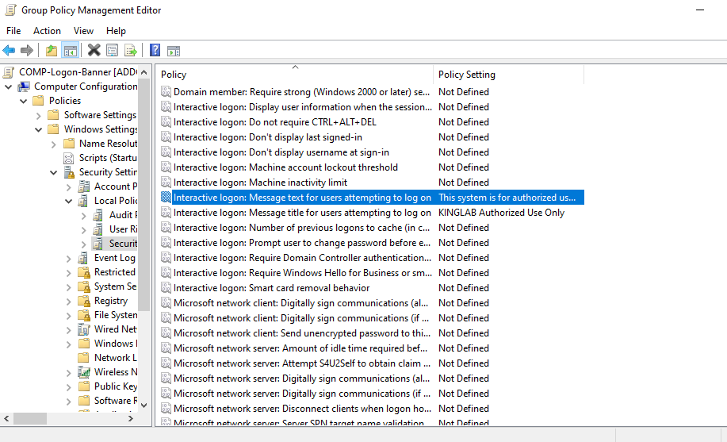
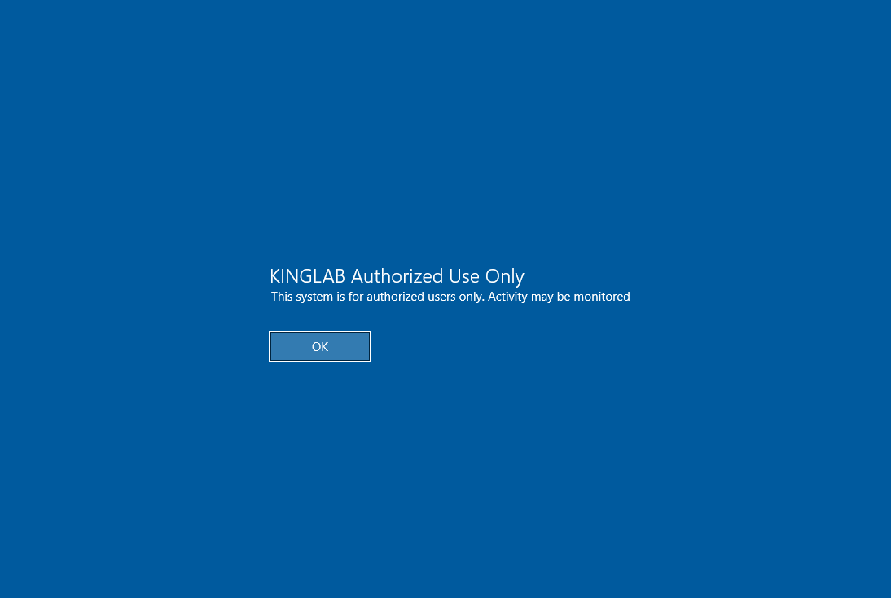

### 15. Verify with gpresult
`gpresult` shows what Windows actually applied. The user report for `msantos` lists `USR-Drive-Mappings` with the Drive Maps extension. The computer report for `CLIENT1` lists `COMP-Logon-Banner` with the Security extension, plus the `Default Domain Policy`, which is inherited from the domain level above the OU. The `Local Group Policy` entry under Denied GPOs has the reason "Empty", because no local settings are configured.
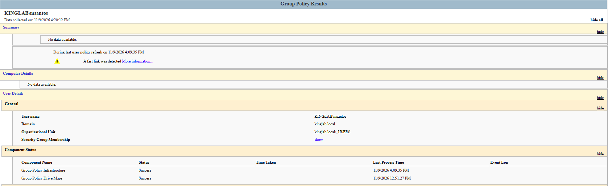
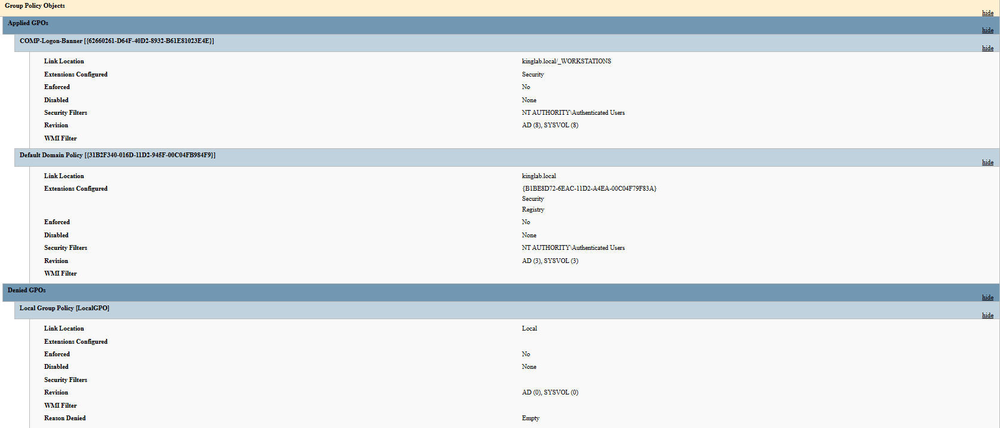
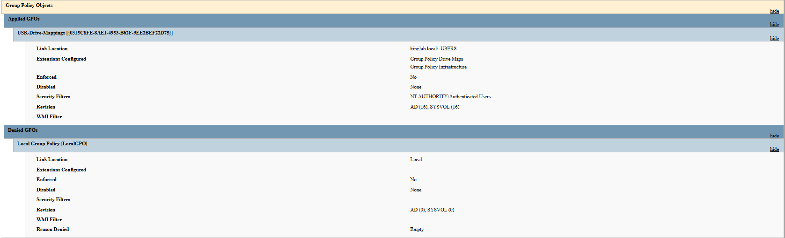

### 16. Verify everything works
| Check | Where / command | Result |
|-------|-----------------|--------|
| HR user opens HR and Company, saves files | `msantos` on CLIENT1 | Pass |
| HR user is denied on Finance and IT | `msantos` on CLIENT1 | Pass (access denied) |
| Control user is denied on all three department folders | `pcruz` on CLIENT1 | Pass (access denied) |
| Control user can use Company | `pcruz` on CLIENT1 | Pass |
| Each user sees only their own drives | This PC on CLIENT1 | Pass: `msantos` S: and H:, `pcruz` S:, `jdelacruz` S: and F:, `mvillanueva` S: and I: |
| Banner shows before sign-in | `CLIENT1` sign-in screen after restart | Pass |
| Both GPOs applied | `gpresult` | Pass |

## Problems I Hit and How I Fixed Them

- **Problem:** The group script reported `FAILED` for all three IT users: "Cannot find an object with identity: 'GG-IT'".
  **Cause:** The group's `SamAccountName` was `GG- IT`, with a stray space. The display name in Active Directory Users and Computers looked right, but `-Identity` matches on `SamAccountName`.
  **Fix:** Found it by listing the groups with `Get-ADGroup`, corrected it, and added the three users again:
  ```powershell
  Set-ADGroup -Identity "GG- IT" -SamAccountName "GG-IT"
  ```
  I then verified with `Get-ADGroupMember` instead of trusting the "Added" messages.
  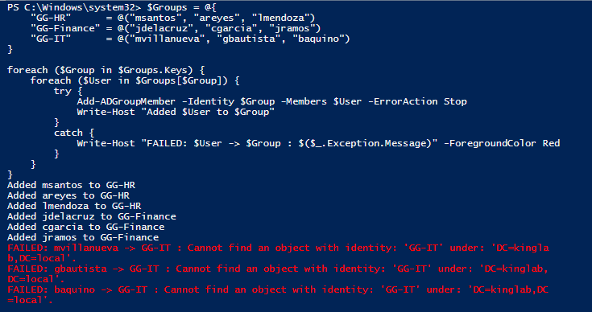
  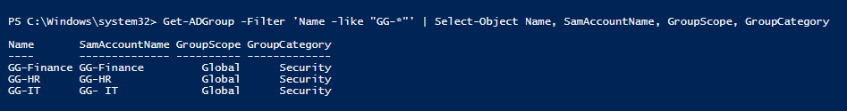

- **Problem:** The `Company` folder had an extra permission entry for a group I did not create in the script (`FileShare_RW`), and an extra `Company` share with `Everyone` at Change.
  **Cause:** Leftovers from an earlier manual attempt I made before the scripted setup. The group contained all ten users, so it was redundant with `Domain Users`.
  **Fix:** Removed the permission entry first, then deleted the group (so the folder was not left with an unresolved SID), then recreated all four shares from one script so they match. I checked the result with `icacls`, `Get-ADGroup` and `Get-SmbShare`.
  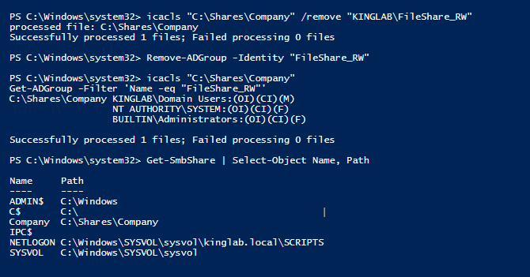

- **Problem:** My first user gpresult report showed `a-ktolentino` instead of `msantos`, and `/scope computer` failed with "Access Denied" from a normal prompt.
  **Cause:** I opened the Command Prompt as administrator with my admin account, and gpresult reported on whichever account was used. Computer scope needs administrator rights, user scope does not. Also, `a-ktolentino` sits in `_ADMINS`, which has no GPO linked, so `USR-Drive-Mappings` correctly did not apply to him.
  **Fix:** Ran the user report from a normal prompt as `msantos` and the computer report from an elevated prompt.

- **Problem:** `whoami /groups` as `pcruz` did not list `KINGLAB\Domain Users`, even though he can use `Company`.
  **Cause:** I did not find a reason for the `whoami` output. `net user pcruz /domain` and `gpresult` both confirm he is in `Domain Users`, and `%LOGONSERVER%` shows he logged on through `ADDC01`, so I used `gpresult` as the evidence.
  **Fix:** None needed for the lab's results.

## Security notes
This is an isolated lab. File shares normally live on a dedicated file server, not on a domain controller, and are only here because the lab has one server. The lab password and "Password never expires" from Lab 1 would not be acceptable in production. Snapshots are a short-term rollback, not a backup, because they sit on the same disk as the VM. Windows 10 reached end of support in October 2025, so it is used here for the lab only.

## What I Learned
- Access is given to groups instead of individual users, so when someone joins or leaves a team I change group membership and never touch the folder permissions.
- Share and NTFS permissions are both checked, and the more restrictive one wins. The share is the front door and NTFS is the real lock.
- Creating a GPO and linking it are different things. A GPO only applies to the users or computers in the OU it is linked to, which is why I built OUs in Lab 1. Group membership does not decide that (unless security filtering is used).
- A user-side GPO follows the person, and a computer-side GPO applies to the machine. That is why the drive maps follow `msantos` while the banner appears before anyone signs in.
- Item-level targeting controls what a user sees, not what they can open. Hiding a drive is a convenience, and the NTFS permissions are the security.
- A script's success message is not proof. In Lab 1 a script printed "Created" while failing, and in this lab a group name with one space broke a script. I now catch errors and verify the result from the system itself.

## What's Next
- Microsoft 365 / Entra ID (Lab 3)

## Credit
Built on my Lab 1 domain. I used an AI assistant (Claude) as a step-by-step guide for this lab, and I explained each step back in my own words and troubleshot the problems above against the real system.
