# Lab 3: Microsoft 365, Entra ID and Conditional Access

## Goal
Add a cloud identity to my lab next to the on-premises domain from Labs 1 and 2. I create a Microsoft 365 tenant, add a regular cloud user, test how MFA behaves under security defaults, and then examine the Conditional Access policies Microsoft creates when security defaults are turned off. The test user signs in on a separate browser session so I see what a normal employee sees, and I check the sign-in logs as evidence instead of trusting what appears on screen.

## Progress
- [x] Microsoft 365 Business Premium trial tenant created
- [x] License, expiry date and recurring billing checked
- [x] Billing account and Entra tenant renamed to KingLab
- [x] Cloud user Maria Santos created with a license and no admin role
- [x] Maria signed in as a normal user
- [x] Microsoft Authenticator registered for Maria
- [x] Security defaults tested, finding documented
- [x] Security defaults turned off
- [x] Existing Conditional Access policies reviewed
- [x] Maria retested under the MFA policy
- [x] Sign-in logs checked as evidence
- [ ] Custom Conditional Access policy of my own

## Environment
| Item | Value |
|------|-------|
| Tenant | Microsoft 365 Business Premium trial, created Nov 10, 2026 |
| Tenant name | KingLab (primary `.onmicrosoft.com` domain, blurred in screenshots) |
| Licenses | 25 in the trial, 2 assigned, plus Microsoft Entra ID P1 |
| Billing | Recurring billing is **off**, so nothing is charged. Trial ends Dec 8, 2026 |
| Admin account | `kingtolentino`, Global Administrator |
| Test user | Maria Santos (`msantos`), cloud-only, usage location Philippines, **no admin role** |
| MFA methods tested | Microsoft Authenticator on a phone, Windows Hello passkey on a lab PC |
| On-premises domain | `kinglab.local`, `ADDC01` (Labs 1 and 2, unchanged) |

## Design

The tenant is a second, separate identity system. It does not replace `ADDC01`. The two are joined later in Lab 5.

| Piece | Job |
|-------|-----|
| On-premises AD (`ADDC01`) | Identity for the lab network |
| Entra tenant (`KingLab`) | Identity for Microsoft 365 and cloud apps |
| License | Decides which services a user gets |
| Role | Decides what an admin may do |
| Security defaults | Microsoft's fixed, tenant-wide MFA baseline |
| Conditional Access | Custom rules for who must do what to sign in |

Security defaults and Conditional Access cannot run together, so security defaults had to be turned off first. When I did, Microsoft created four Conditional Access policies automatically. I did not build them.

| Policy (Microsoft-managed) | State |
|----------------------------|-------|
| Block legacy authentication | On |
| Multifactor authentication for Azure Management | On |
| Multifactor authentication for all users | On |
| Multifactor authentication for admins | On |

## Steps

### 1. Create the tenant
The Microsoft 365 Developer Program sandbox did not qualify for my account, so I used the commercial Business Premium trial.
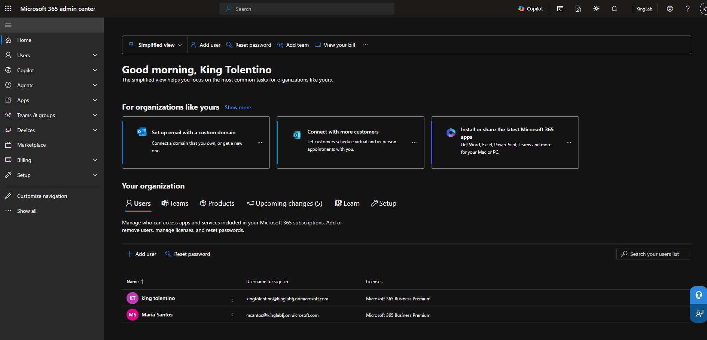

### 2. Check the license, expiry date and recurring billing
Confirmed the trial subscription, its end date (Dec 8, 2026), 25 licenses and that recurring billing is off. A license decides which services a user gets, and charges are controlled by the recurring billing setting.
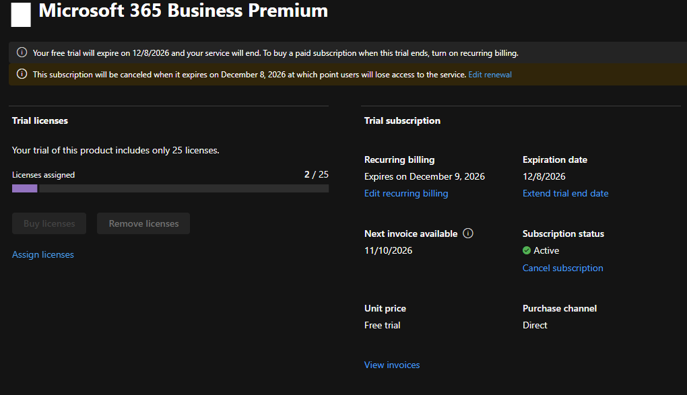

### 3. Rename the tenant
Renamed the billing account and the Entra tenant to `KingLab`.
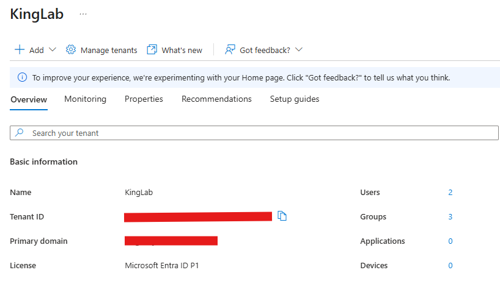

### 4. Confirm security defaults are on
Security defaults were enabled by default. I kept them on to test how they behave before changing anything.
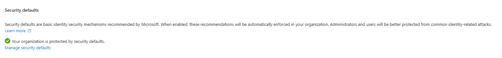

### 5. Create a regular cloud user
Created Maria Santos (`msantos`) as a cloud user with usage location Philippines and **no admin role**. A regular user shows what a real employee experiences, because an admin skips many restrictions. It also follows least privilege: if her account were compromised, the attacker would not control the tenant.
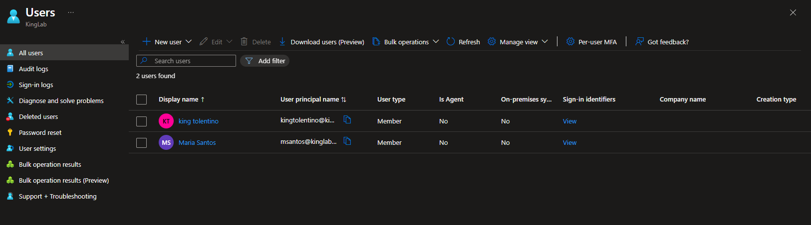

### 6. Assign a license
Assigned Maria a Business Premium license. The account is her identity (sign-in, groups, policies), and the license gives her the services (mailbox, Teams, OneDrive, Office).
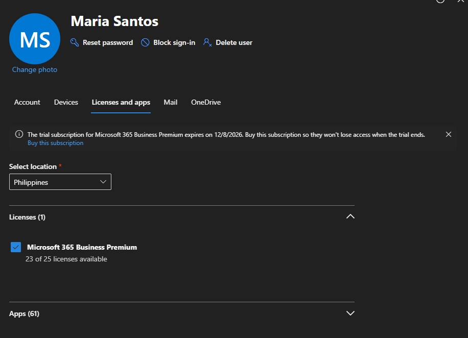

### 7. Sign in as Maria
Signed in as Maria in an InPrivate window. She entered the generated password and was asked to change it. She then landed on the Copilot home page. **No MFA setup was forced**, even with security defaults on.
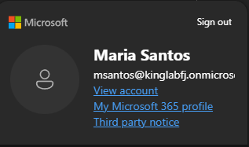

### 8. Register Microsoft Authenticator
Registered Microsoft Authenticator on a phone at `mysignins.microsoft.com/security-info`.
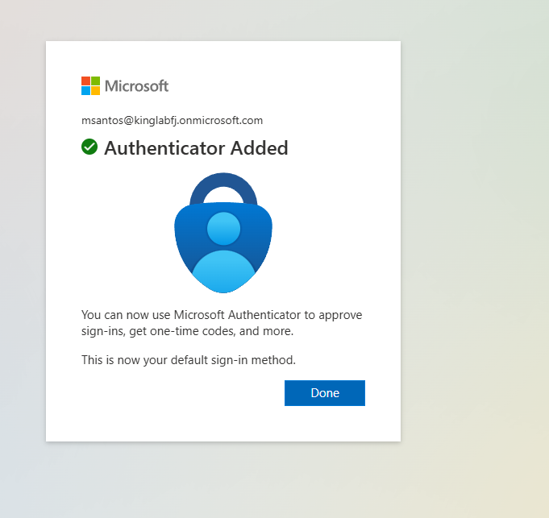

### 9. Sign in again and test MFA
I signed Maria out, closed every InPrivate window and signed in again. I expected an Authenticator approval, but Windows offered to create a **passkey** (Windows Hello), and my phone was never asked to approve anything. Her Security info page then listed three methods: password, Microsoft Authenticator (push) and a device-bound passkey.

Registering a method is not the same as being required to use it. This is Finding 1 below.
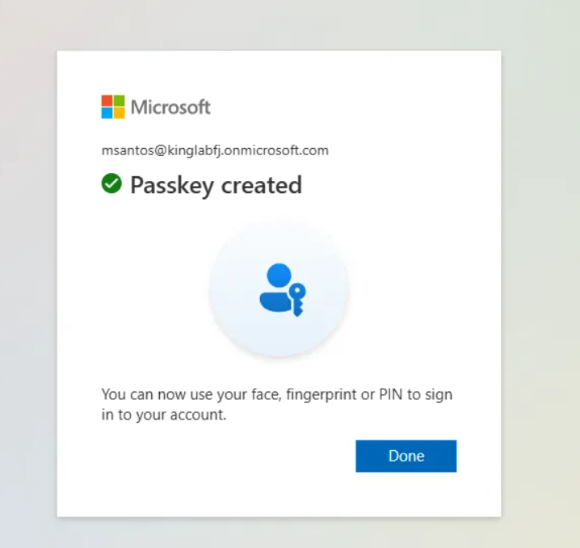
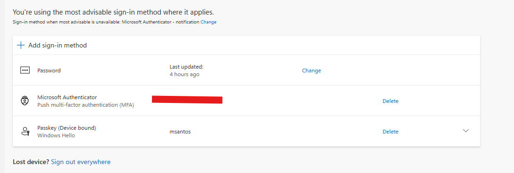

### 10. Turn off security defaults
Security defaults are all-or-nothing and cannot be turned off for one account, so this removed the baseline from my admin account too. Both my admin account and Maria already had Authenticator registered, so neither would hit a surprise registration screen. In Entra ID > Properties > Manage security defaults I set the option to Disabled with the reason "My organization is using Conditional Access". The page now says the organization is using Conditional Access policies, which blocks re-enabling security defaults.
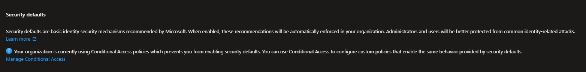

### 11. Review the existing Conditional Access policies
Before building anything I read what was already there. Four Microsoft-managed policies existed, all On, all created on 11/13/2026 within about a minute of each other, which is when I saved the change that turned off security defaults. Policies stack and the strictest result wins, so reading them first avoids conflicts and lockouts.
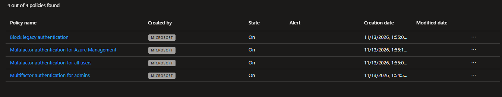

### 12. Read the "Multifactor authentication for all users" policy
Read-only, nothing changed. The policy includes all users and all resources and requires multifactor authentication. It excludes one role, **Directory Synchronization Accounts**. Those are service accounts that sync an on-premises directory with Entra ID, such as the sync in Lab 5. They sign in automatically and cannot answer an MFA prompt, so the exclusion is expected.
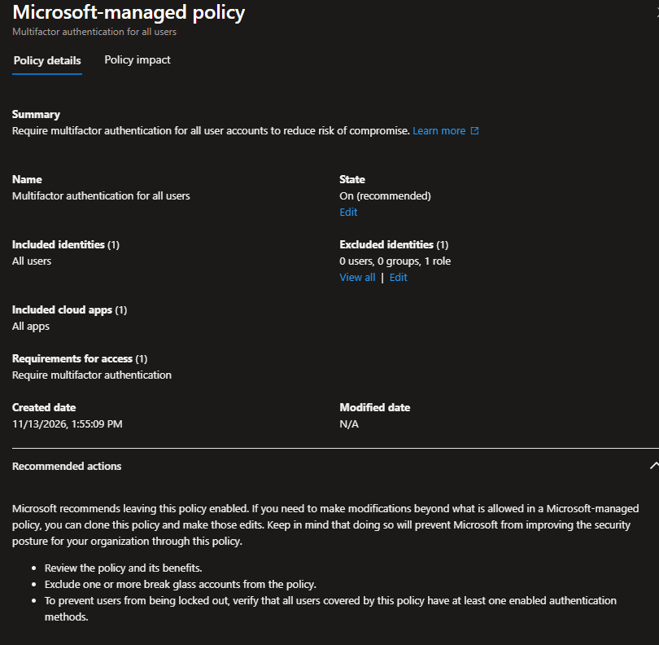

### 13. Retest Maria under the policy
Signed Maria in again. Windows Security asked for her Windows Hello PIN to use the passkey. `portal.office.com` redirected to the Copilot home page, which is the normal behavior. Copilot showed a blank page at first and loaded after a few refreshes and sign-ins.
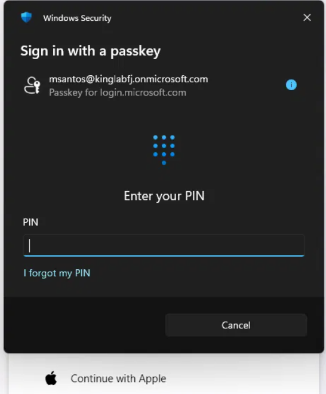

### 14. Check Maria's sign-in log
In Entra ID > Monitoring & health > Sign-in logs I filtered for Maria. Log times are UTC (06:21Z is 2:21 PM in the Philippines).

- The list shows an **Interrupted** entry followed by a **Success** entry with the same request ID, the pattern of a sign-in that paused for something more.
- The Conditional Access tab shows the MFA policy **Enabled**, Maria and the app both **Matched**, and Grant Controls **Satisfied**.
- On the Interrupted entry (06:21:56Z), Authentication details show **Passkey (device-bound)** with **Succeeded: Yes**, plus a **Previously satisfied** row.
- On the Success entry (06:21:59Z), the only row is **Previously satisfied**, with an MFA requirement result detail that was cut off in my screenshot.
- My admin sign-in earlier that day shows Conditional Access as **Not applied**, which fits the timing before the policies were created. I inferred that from the timestamps.

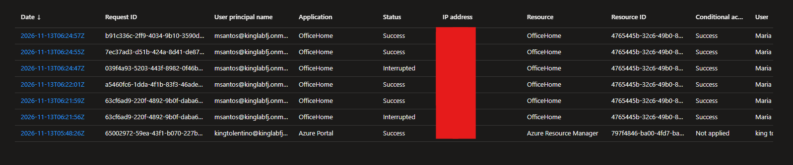
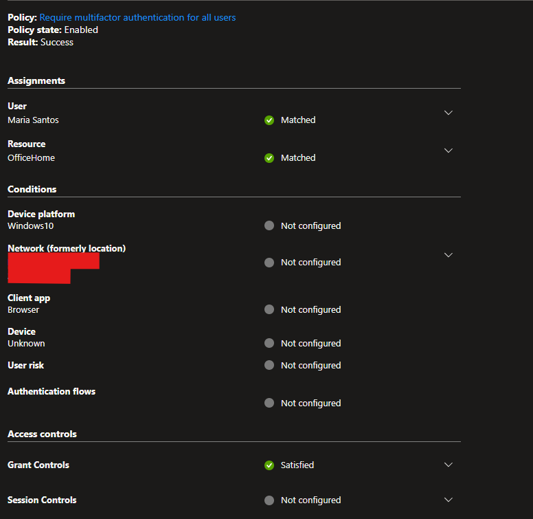
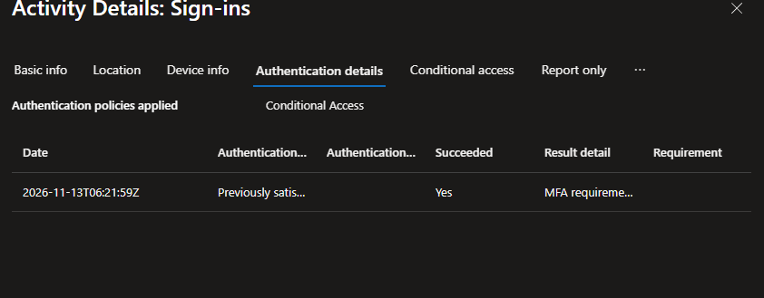
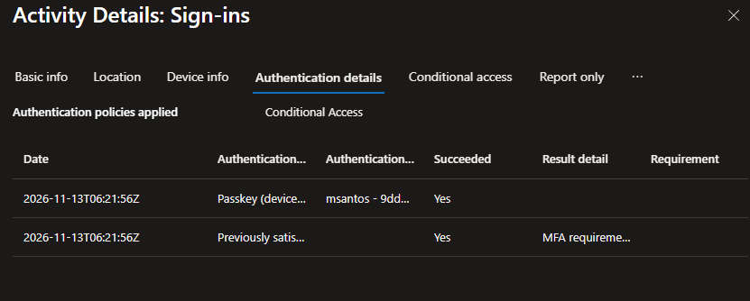

### 15. Verify everything works
| Check | Where / command | Result |
|-------|-----------------|--------|
| Tenant, license and billing settings | Admin center | Pass: trial ends Dec 8, 2026, recurring billing off |
| Maria has a license and no admin role | Users list | Pass |
| Maria has registered methods | Security info | Pass: Authenticator and a passkey |
| Security defaults forced MFA | Maria's sign-ins before the change | **Not observed** (Finding 1) |
| Security defaults are off | Entra ID > Properties | Pass |
| MFA policy is On and covers Maria | Policy and sign-in log | Pass: user and app Matched |
| Maria met the MFA requirement | Sign-in log | Pass: device-bound passkey succeeded |
| Authenticator push approval seen in a log | Sign-in log | **Not observed**: both tests used the passkey |
| Custom Conditional Access policy | Entra ID | Not built yet |

## Findings

**Finding 1: Security defaults did not force MFA on Maria.** After Authenticator was registered, her next sign-in was never challenged with an Authenticator approval. Windows offered a passkey instead. In my test, security defaults did not challenge every sign-in, so a registered method could go unused.

**Finding 2: Microsoft created the Conditional Access policies.** I turned off security defaults only because Microsoft does not allow both together. The four MFA and legacy-authentication policies were created automatically. I did not build them, and this README does not claim otherwise.

**Finding 3: The logs show the policy applied and its requirement was met.** They do not show that Authenticator push was used, and they do not prove the requirement was met only because of this policy.

## Problems I Hit and How I Fixed Them

- **Problem:** The Microsoft 365 Developer Program sandbox did not qualify me.
  **Cause:** The program did not accept my account.
  **Fix:** Used the commercial Business Premium trial with recurring billing off.

- **Problem:** I expected Maria's second sign-in to ask for an Authenticator approval, and a passkey prompt appeared instead.
  **Cause:** Security defaults do not challenge every sign-in, and Microsoft offers a passkey as the preferred method when one can be created.
  **Fix:** Documented it as Finding 1 and used the Conditional Access policy and the sign-in logs as the real test.

- **Problem:** After I opened the Security defaults page, it still said the organization was protected by security defaults.
  **Cause:** I had not yet clicked Manage security defaults and saved the change.
  **Fix:** Disabled it from the Manage security defaults panel and checked that the page changed.

- **Problem:** Copilot showed a blank page after sign-in, and `portal.office.com` redirected to Copilot.
  **Cause:** The redirect is the current behavior. I did not find the cause of the blank page, and it was not related to MFA.
  **Fix:** Refreshed and signed in again until Copilot loaded. The sign-in log, not the page, was my evidence.

- **Problem:** The Authentication details on the Success entry showed only "Previously satisfied", not the actual challenge.
  **Cause:** The challenge is recorded on the Interrupted entry, and the Success entry reuses it.
  **Fix:** Opened the Interrupted entry, which shows the passkey succeeded.

## Security notes
This is a trial tenant with no real data. Screenshots have the Tenant ID, personal email, domain name, IP address and location blurred or cropped out, and the billing account and billing profile pages are not published. Turning off security defaults removes the baseline MFA for every account, including the admin, until a policy covers it. In this lab Microsoft's managed policies covered that gap, and both accounts already had a method registered. In a real company I would build the policy in report-only mode first. The trial ends Dec 8, 2026, so I will export my work and cancel before then.

## What I Learned
- A tenant adds a cloud identity for Microsoft 365. It does not replace `ADDC01`, and Lab 5 connects the two.
- A license decides which services a user gets, a role decides what an admin may do, and billing is controlled by the recurring billing setting.
- The account is the identity and the license gives the services.
- Least privilege: Maria has no admin role so a compromised account has limited reach, and so I see what a normal user sees.
- A user with no MFA method is a risk because anyone who knows the password can sign in, and an attacker could register their own device first.
- Registered is not the same as required: having a method on file does not force its use.
- Security defaults are all-or-nothing and cannot run together with Conditional Access, so the switch affects every account.
- Reviewing existing policies before creating new ones matters because policies stack and the strictest result wins.
- The sign-in log is stronger evidence than an on-screen prompt because it records which policy was evaluated, which conditions matched and whether the requirement was met.

## What's Next
- Conditional Access: build a custom policy of my own
- Intune (Lab 4)
- Connect `ADDC01` to the tenant (Lab 5)

## Credit
Built next to my Lab 1 and Lab 2 domain. I used an AI assistant (Claude) as a step-by-step guide for this lab, and I explained each step back in my own words and checked the results against the real tenant and its sign-in logs.
