# Lab 4: Intune Device Management

**Status:** Completed (Nov 14-15, 2026)
**Skills:** Microsoft Intune enrollment, Mobile Device Management (MDM) user scope, pilot groups, compliance policies, configuration profiles, app deployment, reading Intune reports

---

## Goal

Lab 3 gave me a cloud tenant with a licensed user. In this lab I used that tenant to manage a real Windows device with Microsoft Intune: enroll it, check it against a compliance policy, push a setting to it, and deploy an app to it. I wanted to see the same kind of work I did in Lab 2 with Group Policy, but delivered over the internet instead of from my domain controller `ADDC01`.

## Progress

| Step | What I did | Status |
|---|---|---|
| 1 | Checked the Intune tenant status (read-only) | Done |
| 2 | Checked Maria's license for Intune | Done |
| 3 | Created the pilot group `Intune-Pilot-Users` | Done |
| 4 | Set the MDM user scope to the pilot group | Done |
| 5 | Built a clean test VM (virtual machine) `CLIENT-INTUNE` | Done |
| 6 | Signed in as Maria during setup (joined Entra ID) | Done |
| 7 | Confirmed the device enrolled in Intune | Done |
| 8 | Created compliance policy `WIN-Compliance-Baseline` | Done |
| 9 | Verified the device was evaluated | Done |
| 10 | Created config profile `WIN-Config-Logon-Banner` | Done |
| 11 | Verified the banner on the VM and in Intune | Done |
| 12 | Deployed VLC as a Required app | Done |
| 13 | Verified VLC on the VM and in Intune | Done |

## Environment

- **Tenant:** KingLab, Microsoft 365 Business Premium trial from Lab 3 (25 licenses, 2 assigned). The trial ends Dec 8, 2026 and recurring billing is off.
- **Test user:** Maria Santos (`msantos`), cloud-only, Business Premium license, no admin role.
- **Admin account:** `kingtolentino` (Global Administrator).
- **Test device:** VMware Workstation VM `CLIENT-INTUNE`, Windows 11 Pro, 8 GB RAM, 4 processors, 130 GB disk, NAT (Network Address Translation) networking, virtual TPM (Trusted Platform Module). It shows up in Intune as `DESKTOP-5COKM7R`.
- **Guide:** mbusbee505 Intune lab, used as the written guide. I added the why behind each step.

## Design

- **A new VM instead of `CLIENT1`.** `CLIENT1` is joined to `kinglab.local` from Labs 1 and 2. Joining it to the cloud tenant would change the machine those labs were built on. Lab 5 is where I connect the two on purpose. A clean VM also means any result comes from what I did in this lab, with no old domain or management history mixed in.
- **A pilot group instead of everyone.** All three Intune objects in this lab (the MDM scope, the compliance policy, the config profile) and the app target only `Intune-Pilot-Users`. If a policy had a mistake, it could only hit my one test device.
- **Policies left in place after the lab.** I kept the enrolled VM, both policies and the scope so I can keep practicing before the trial ends.

---

## Steps

### Step 1: Check the Intune tenant status

**Why:** Before changing anything I wanted a baseline, so I could prove later what changed.

Tenant status showed MDM authority **Microsoft Intune**, 25 licenses and **0 enrolled devices**. The Devices overview showed 0 devices on every platform.

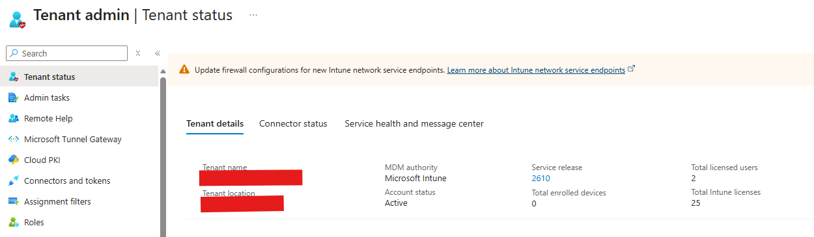
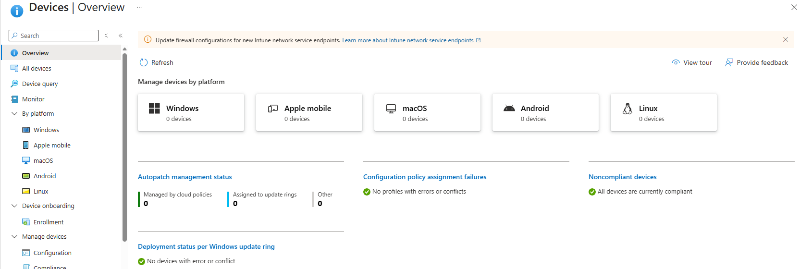

### Step 2: Check Maria's license for Intune

**Why:** A license decides which services a user gets. If Intune were missing from her license, she could still sign in but enrollment would fail.

Maria's Business Premium license is active, assigned directly, and Microsoft Intune is listed as an assigned service plan.

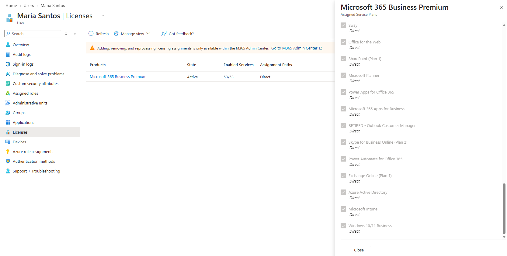

### Step 3: Create the pilot group

**Why:** Intune assigns policies and apps to groups. Using a group means adding or removing a user is one change, and no policy has to be edited. It is the same pattern as `GG-HR`, `GG-Finance` and `GG-IT` in Lab 2.

I created a security group `Intune-Pilot-Users` with Maria as its only member.

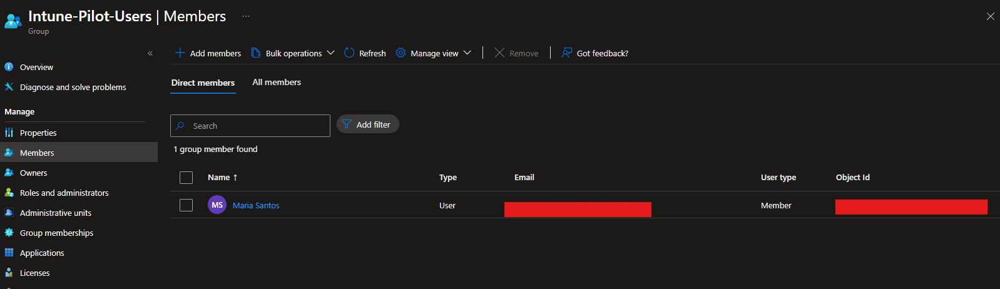

### Step 4: Set the MDM user scope

**Why:** The MDM (Mobile Device Management) user scope decides whose devices can enroll automatically. It was set to **None**, so no device could enroll even with a valid license.

I changed it to **Some** and selected `Intune-Pilot-Users`. I left the Windows Information Protection (WIP) scope on **None**.

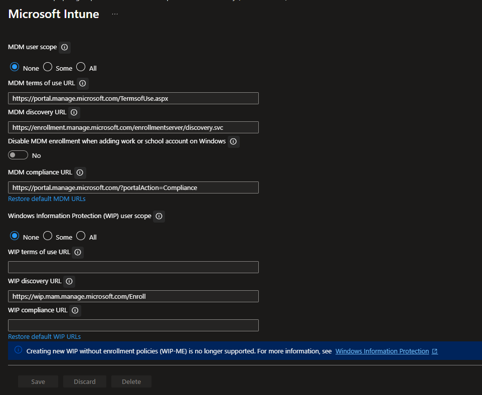
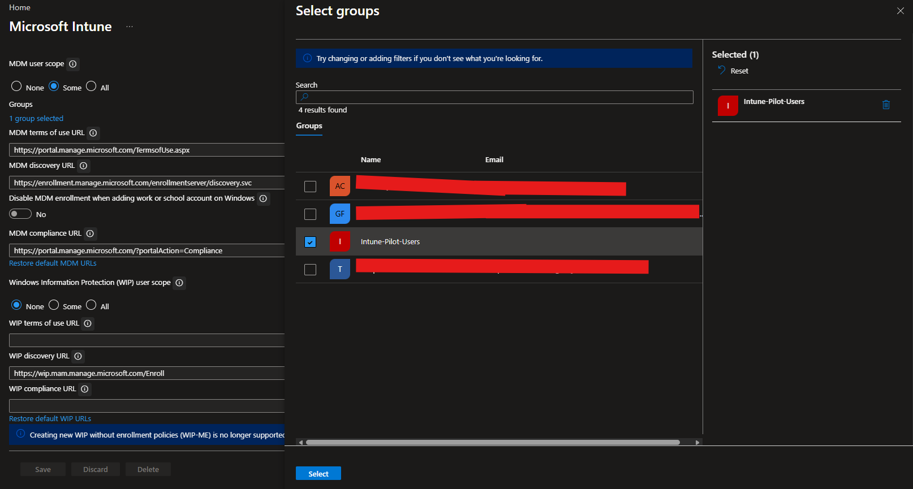

> Note: `04b` was taken with the group picker still open, so it shows the setting as I configured it, not a fresh page load after saving. The real proof the scope worked is Step 7, where the device enrolled.

### Step 5: Build the test VM

**Why:** The enrollment test needs a clean Windows machine that has never been joined to `kinglab.local`.

I created `CLIENT-INTUNE` in VMware Workstation from a Windows 11 Pro ISO and stopped at the first setup screen (the out-of-box experience, OOBE) before signing in or joining anything.

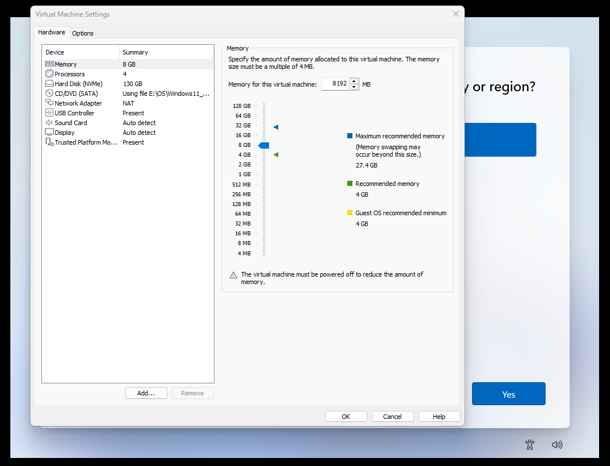

### Step 6: Sign in as Maria during setup

**Why:** Adding a work account during setup joins the device to the tenant's Entra ID. Because Maria is in the MDM scope group and licensed, Windows then enrolls the device in Intune automatically.

I chose **Set up for work or school**, signed in as Maria, approved multi-factor authentication (MFA) with Microsoft Authenticator, and created a Windows Hello PIN. Settings > Accounts > Access work or school then showed the account connected to KingLab's Entra ID.

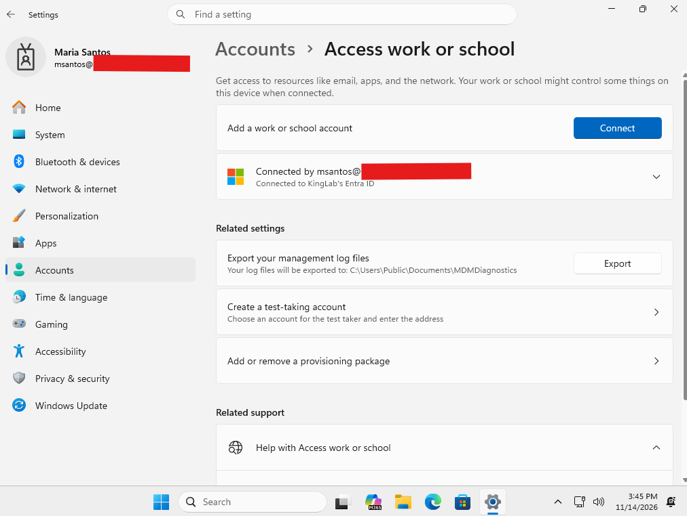

> Joining Entra ID is not the same as enrolling in Intune. This screenshot proves the first. It does not prove Intune manages the device.

### Step 7: Confirm the device enrolled in Intune

**Why:** This is the check that shows the license (Step 2) and the MDM scope (Step 4) worked together.

The device `DESKTOP-5COKM7R` appeared in Intune with the **Intune** tag, **Corporate** ownership, Maria Santos as primary user and a recent check-in. The Devices overview went from 0 to **1 Windows device**.

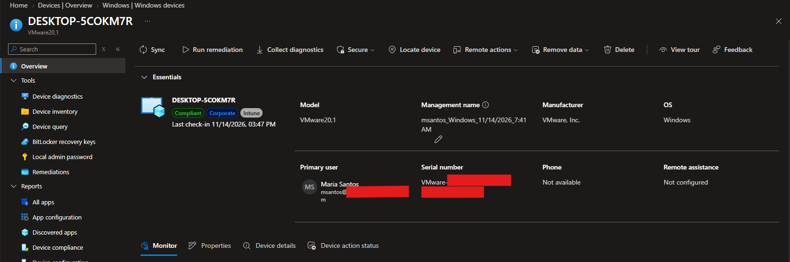
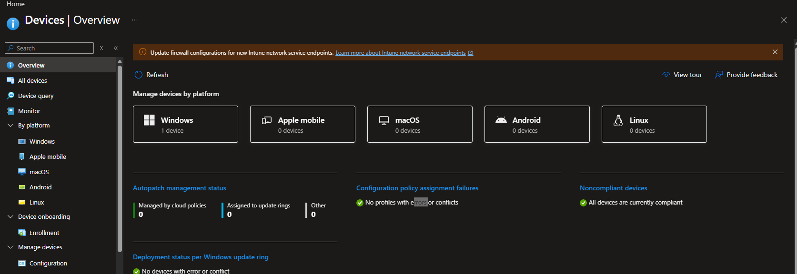

> The **Compliant** badge in this screenshot did not mean the device passed any checks. No compliance policy existed yet.

### Step 8: Create a compliance policy

**Why:** A compliance policy defines the rules a device must meet. Without one, the Compliant badge has nothing behind it.

I created `WIN-Compliance-Baseline` for Windows 10 and later. **Firewall**, **Antivirus** and **Antispyware** are set to **Require**, and the noncompliance action is to mark the device noncompliant immediately. It is assigned to `Intune-Pilot-Users` only, with no exclusions.

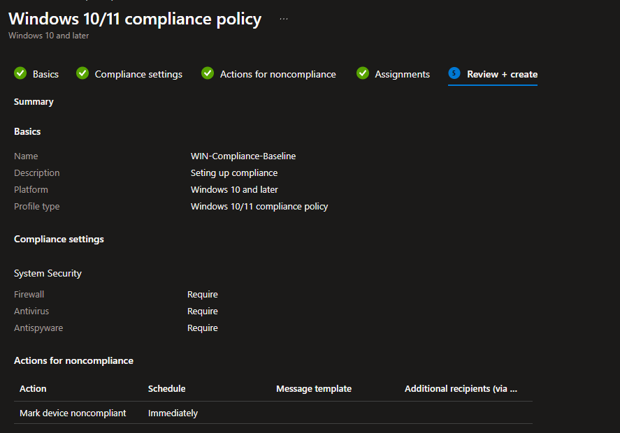
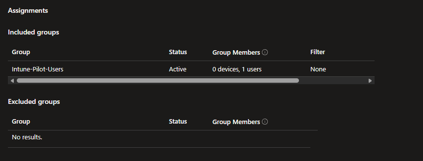

### Step 9: Verify the device was evaluated

**Why:** Assigning a policy does not mean the device has been checked. The device has to check in and report back.

At first the device's compliance page listed only the built-in **Default Device Compliance Policy** with state **Error** (failing check: "Has a compliance policy assigned", detail `65001 (Not applicable)`). After more check-ins `WIN-Compliance-Baseline` appeared. The per-setting status showed **1 compliant device and 0 in every other column** for all three settings, and the device's compliance page showed both policies as **Compliant**.

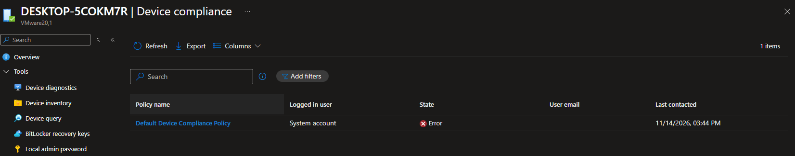
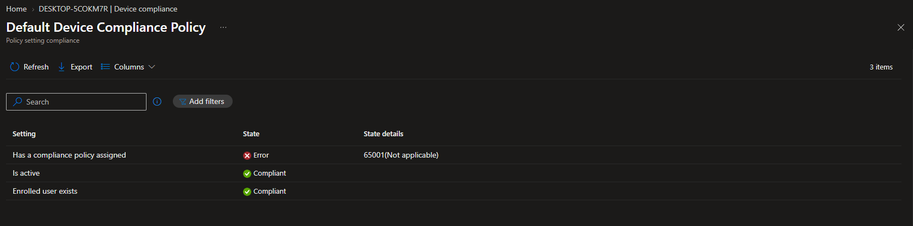
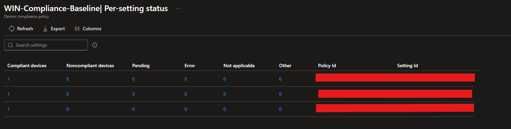
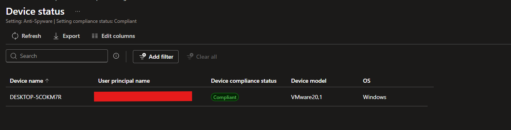
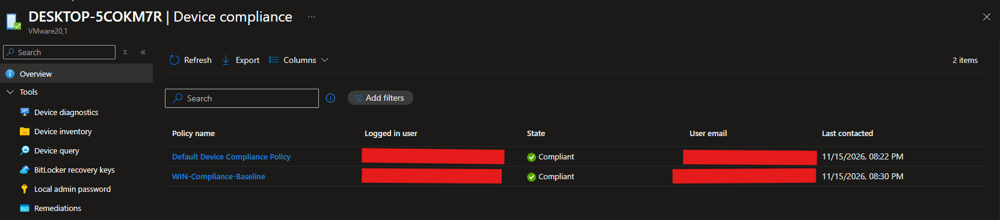

### Step 10: Create a configuration profile

**Why:** A compliance policy only checks a device. A configuration profile changes it. This is the Intune version of my Lab 2 `COMP-Logon-Banner` GPO (Group Policy Object).

I created `WIN-Config-Logon-Banner` from the Settings catalog (Local Policies Security Options): message title `Authorized Use Only` and message text `This device is managed by KingLab IT.` It is assigned to `Intune-Pilot-Users` only.

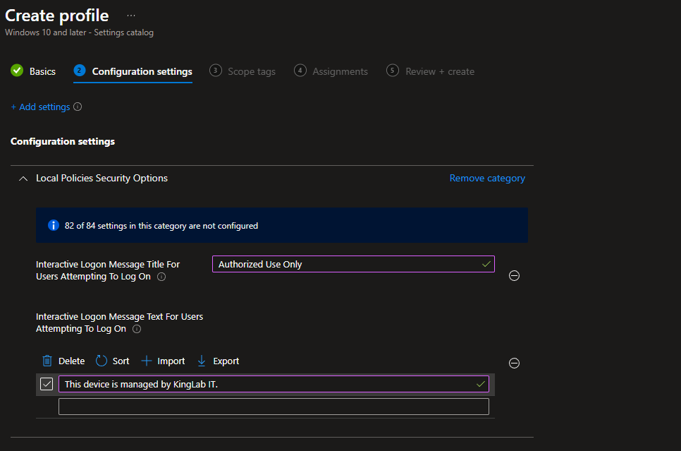
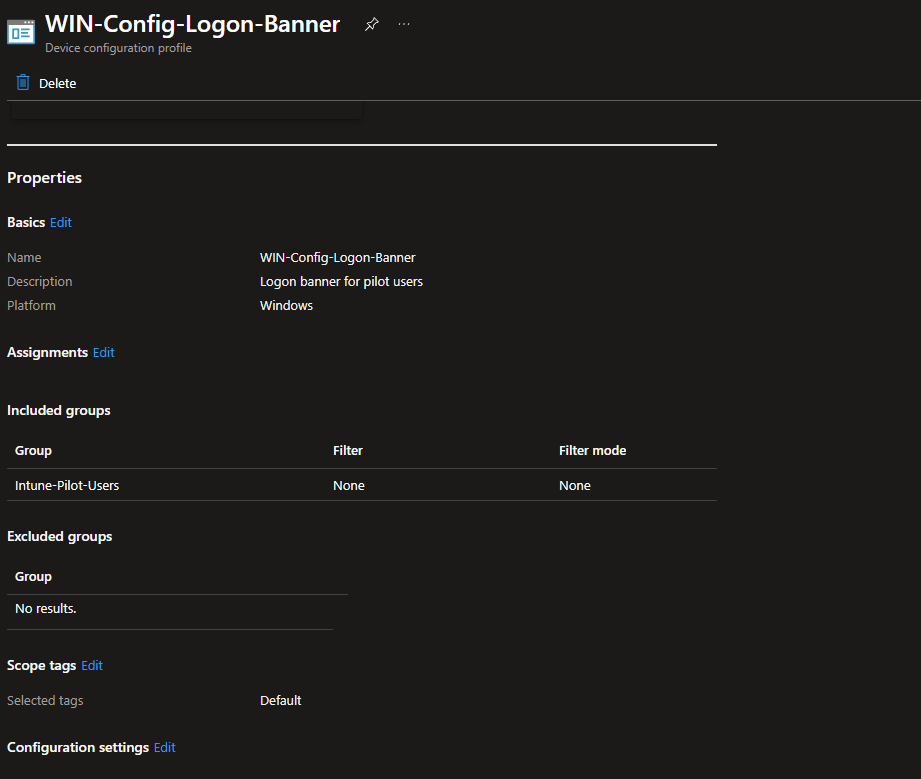
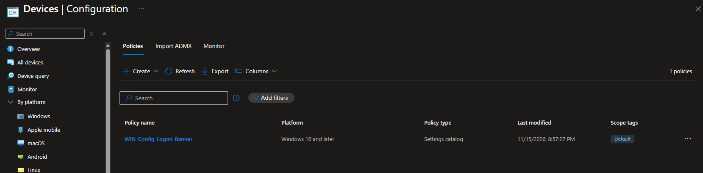

### Step 11: Verify the banner

**Why:** Creating a profile only means Intune is ready to deliver it. The proof is on the machine.

After a sync and a restart, the banner appeared on the `CLIENT-INTUNE` sign-in screen with my exact wording. Intune's profile report stayed empty for a long time (see Problems I Hit), then showed **Succeeded 1** with check-in status **Success**.

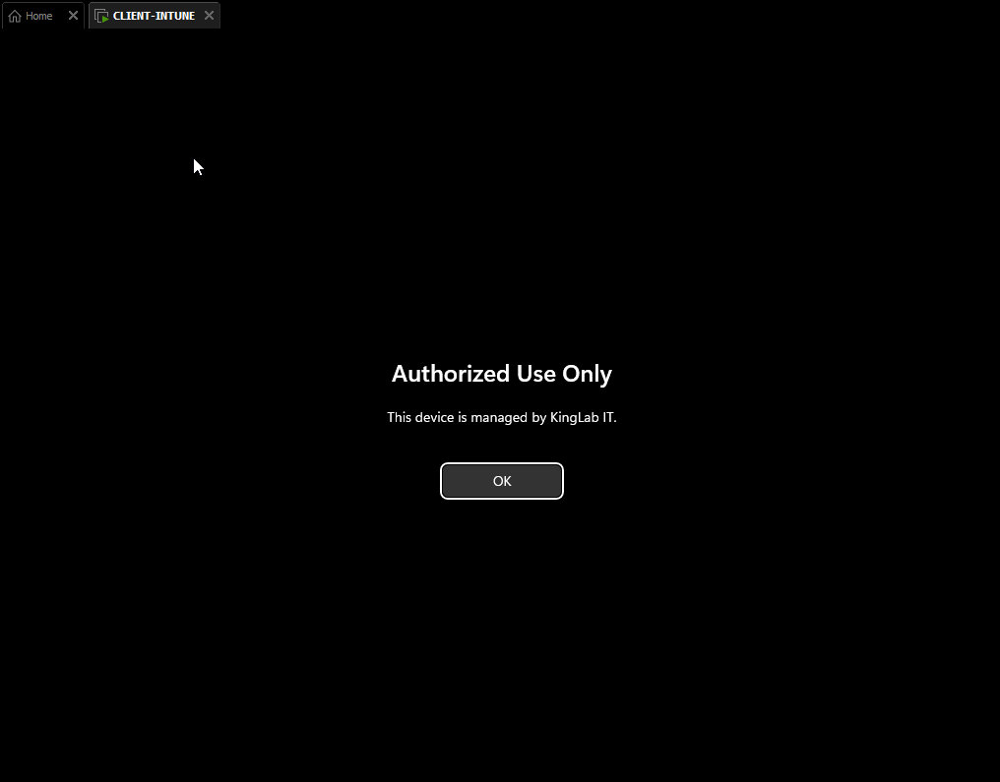
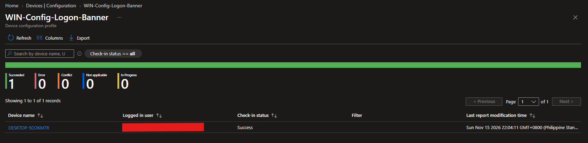

### Step 12: Deploy an app

**Why:** Deploying software is the other everyday device-management job. In Lab 2 I mapped drives with GPO. Here Intune installs an app over the internet with nobody touching the VM.

I added **VLC** as a Microsoft Store app (new). When first created, the **Assigned** column said **No**, so nothing would have installed. I then assigned it under **Required** to `Intune-Pilot-Users` only, with the install deadline **As soon as possible**.

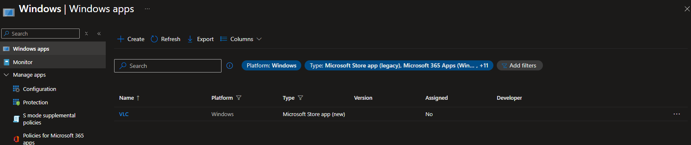
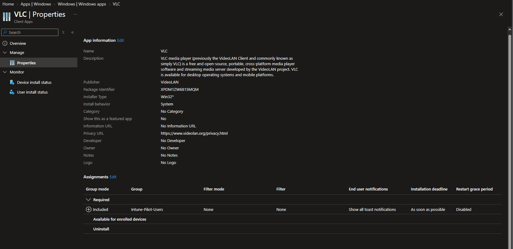

### Step 13: Verify the app installed

**Why:** The assignment proves who the app is aimed at. It does not prove anything arrived.

On the VM, Settings > Apps > Installed apps listed **VLC media player 3.0.23** from VideoLAN, installed 11/15/2026. I never installed it by hand. Intune's app overview then showed **Installed 1** for both device status and user status.

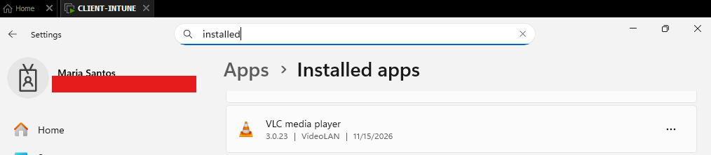
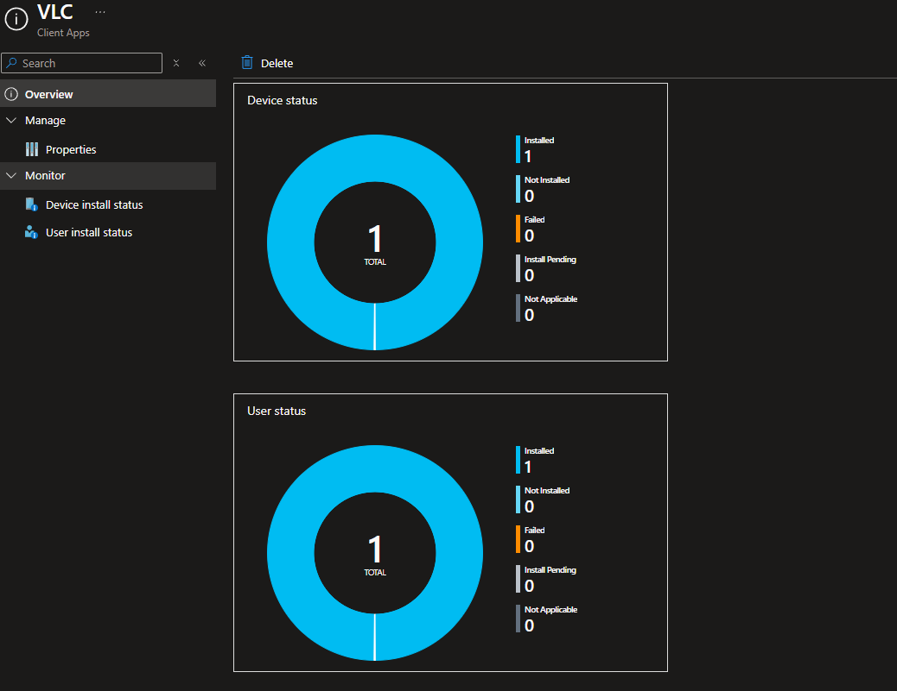

---

## Verify

| Check | Expected | Result | Evidence |
|---|---|---|---|
| Baseline before changes | 0 enrolled devices | 0 devices | `01`, `01b` |
| Maria licensed for Intune | Intune service plan assigned | Assigned | `02` |
| Device joined the tenant | Connected to KingLab's Entra ID | Connected | `07` |
| Device enrolled in Intune | Listed with Intune tag | Listed, 1 Windows device | `08`, `09` |
| Compliance evaluated | Passes the three rules | 1 compliant on each setting | `11c`, `11d`, `11-compliance-evaluated` |
| Banner delivered | Banner on sign-in screen | Shown on the VM | `13a` |
| Banner reported by Intune | Succeeded 1 | Succeeded 1 (after a delay) | `13b` |
| App delivered | VLC on the VM | VLC 3.0.23 installed | `16a` |
| App reported by Intune | Installed 1 | Installed 1 | `16b` |

## Findings

1. **The Compliant badge looked identical before and after, but meant something different.** In `08` no compliance policy existed, so nothing had been checked. In the final compliance screenshot the device had been checked against three rules and passed. The badge alone proves nothing. The page behind it (per-setting status and the policy list) is the evidence.
2. **Joining Entra ID and enrolling in Intune are two separate events.** The first gives the device an identity in the tenant. The second lets Intune manage it. `07` shows the first and `08` shows the second.
3. **Enrollment needed both the license and the MDM scope.** The license says Maria may use Intune. The scope says her device should enroll when she signs in. Without either one, enrollment would not have happened.
4. **The device was a faster source of truth than the portal.** The banner and VLC were on the VM well before Intune's reports showed them. I can say the reports lagged because the timestamps show it. I cannot say why.
5. **Group Policy and Intune delivered the same Windows setting differently.** The logon banner is the same setting in Lab 2 and Lab 4. GPO delivered it from `ADDC01` to a domain-joined machine on my lab network. Intune delivered it over the internet to an enrolled machine that was never joined to `kinglab.local`.

## Problems I Hit

1. **The compliance policy did not reach the device at first.** After assigning it, the device's compliance page listed only the default policy with an Error state, and a restart and sync did not change that right away. `WIN-Compliance-Baseline` appeared after more time and check-ins. I did not confirm why it took that long.
2. **A conflicting status for a while.** The policy's own page showed the device as **Error** in the "Others" bucket while the per-setting pages already showed **Compliant**. Later the device page showed **Compliant** for both policies. My reading is that the first page was behind, but I did not prove it.
3. **Two settings changed by accident on the MDM page.** While selecting the group, the "Disable MDM enrollment when adding work or school account on Windows" toggle flipped to **Yes** and the WIP scope changed to **Some**. I set the toggle back to **No** and the WIP scope back to **None** before the final save, which matches the values shown in `04b`. If the toggle had stayed on Yes, enrollment would have been blocked.
4. **Banner values in the wrong boxes.** In the first version of the profile, the message text was entered in the title box and the text box was empty. I corrected both before creating the profile.
5. **The app was created but not assigned.** The **Assigned** column said **No** after creation. I added the Required assignment afterward.
6. **Intune's reports lagged behind the device.** The banner profile's report and the device's configuration page both showed no results while the banner was already on the VM. The device configuration page carried a notice that the report may be delayed. The profile report later showed **Succeeded 1**.

## Security notes

- Screenshots were checked for emails, the tenant domain, tenant ID, device ID, serial numbers and the account name before upload. Pushed files stay in Git history, so I checked each one in an image viewer first.
- Everything targets a pilot group, so a mistake could only affect one test device.
- **Compliant** here means the device met three rules (firewall, antivirus, antispyware). It does not mean the device is fully secure.
- The compliance policy only reports. Nothing blocks a noncompliant device yet, because that needs a Conditional Access policy that requires a compliant device. That is a separate lab.
- The trial ends Dec 8, 2026 with recurring billing off. I will export my work and cancel before then.

## What I Learned

- **Assigned is not installed.** Assigned means I told Intune to deliver something. Installed means it is on the device. `15b` shows the assignment and `16a` shows the install. An app can be assigned and never arrive, as `15a` showed for a moment.
- **Required forces an install, Available only offers it.** I used Required on a pilot group so a bad deployment could only affect one test device, not every enrolled device.
- **Groups make changes small.** Putting users in a group and assigning to the group means a joiner or leaver is one change.
- **The MDM scope is a gate.** With the scope on None, no user's device enrolls automatically. Some lets in only the group I choose. All lets in everyone.
- **Verify on the device first, then in the portal.** The device shows the quick answer. The report gives the record and the scale.
- **Check settings I did not mean to change.** The two accidental changes on the MDM page would have broken the lab if I had not noticed them.

## What's Next

- Keep the enrolled VM, both policies and the pilot scope in place until the trial ends, to keep practicing.
- A separate lab for my own Conditional Access policy in report-only mode, including one that requires a compliant device, done while the trial's Entra ID P1 features are available.
- Export my work before Dec 3 and cancel the trial before Dec 8.

## Credit

I used an AI assistant (Claude) as a step-by-step guide, explained each step back in my own words, and checked the results against the real system.
